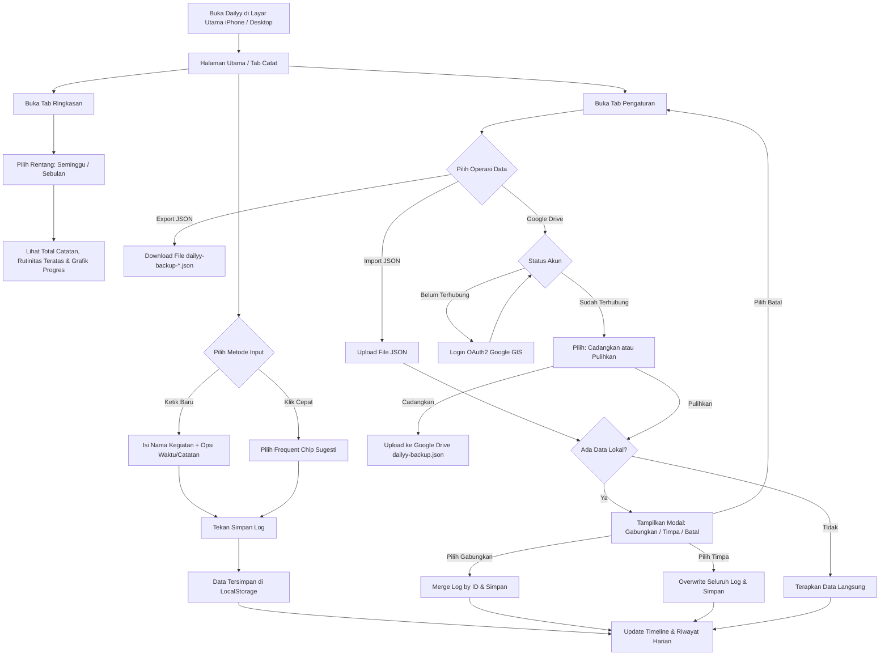

# Product Requirements Document (PRD) - v1.1

## Project: Dailyy - Personal Activity Log (Offline-First PWA)

---

### 📌 Dokumen Kontrol & Riwayat Versi (Changelog)

| Versi | Tanggal | Penulis | Ringkasan Perubahan Utama |
| :---: | :---: | :---: | :--- |
| **v1.0** | Awal Projek | Yodi | Dokumen awal MVP (Personal Activity Log / AktivitasKu). Scope: Offline-first PWA, input log, timeline, ringkasan mingguan/bulanan, backup JSON lokal. (Cloud sync dinyatakan out-of-scope). |
| **v1.1** | Oktober 2026 | Yodi & AI Assistant | **Revisi Sinkronisasi Status Aplikasi:** 1. Branding resmi menjadi **Dailyy**. 2. Peningkatan **Google Drive Backup & Restore (Zero-Cost Cloud Sync)** dari *Out of Scope* menjadi fitur utama. 3. Penambahan **Modal Konfirmasi Pemulihan Data (Merge vs Replace)** untuk mencegah kehilangan data. 4. Auto-refresh token Google OAuth (Error 401 recovery). 5. Integrasi halaman legalitas: **Privacy Policy** & **Terms of Service**. 6. PWA Auto-Update & tombol manual "Periksa Update". 7. Update Tech Stack ke Tailwind CSS v4 & Lucide Vue modern. |

---

### 1. Ringkasan Eksekutif & Latar Belakang

**Dailyy** adalah aplikasi pencatat aktivitas harian personal (*habit & activity tracker*) yang dirancang khusus untuk memantau rutinitas dan frekuensi kegiatan sehari-hari (misalnya: *nyuci baju*, *olahraga*, *baca buku*, *belajar koding*).

Aplikasi ini mengedepankan prinsip:
1. **Local-First & Offline-Ready:** Data primer tersimpan aman di perangkat pengguna dan aplikasi dapat digunakan tanpa koneksi internet.
2. **PWA Standalone di iPhone 8 (iOS 16):** Dapat dipasang langsung melalui menu *"Add to Home Screen"* di Safari tanpa membutuhkan App Store.
3. **Zero-Cost (Rp 0):** Beroperasi tanpa biaya domain, server berbayar, database cloud komersial, maupun lisensi developer Apple.
4. **Cadangan Cloud Pribadi Bebas Biaya:** Pengguna dapat mencadangkan dan memulihkan data langsung ke Google Drive pribadi mereka secara aman via protokol OAuth2 resmi Google.

---

### 2. Sasaran & Kriteria Keberhasilan (Success Metrics)

- **Biaya Operasional Rp 0:** Seluruh arsitektur (hosting static, Google Drive API personal, service worker) berbiaya nol rupiah.
- **PWA Kompatibilitas iOS 16:** Berjalan *standalone* (fullscreen tanpa address bar Safari) dan mendukung safe-area insets pada iPhone 8.
- **Keandalan Mode Offline:** Aplikasi dapat dibuka, menampilkan riwayat, serta mencatat kegiatan baru meski perangkat berada dalam *Airplane Mode*.
- **Kecepatan Pencatatan (< 5 detik):** Alur pencatatan instan dengan tombol *quick chips* (sugesti satu klik).
- **Proteksi Data (Zero Data Loss):** Perlindungan penuh saat proses *restore* atau *import* data melalui opsi **Gabungkan (Merge)** atau **Timpa (Replace)**.

---

### 3. Batasan Platform & Perangkat

- **Target Perangkat Utama:** iPhone 8 (maksimal iOS 16.7.x) via Mobile Safari PWA.
- **Dukungan Lintas Platform:** Android (Google Chrome PWA) dan Desktop Browser (Chrome, Edge, Safari).
- **Desain & Responsivitas:** Desain modern dark mode (`slate-950`), tata letak ramah ibu jari (*thumb-zone navigation*), dan adaptif terhadap safe-area inset (bezel/notch).

---

### 4. Ruang Lingkup Fitur (Feature Scope v1.1)

#### 4.1. Quick Log Entry (Pencatatan Cepat)
- **Input Teks Utama:** Input nama kegiatan dengan placeholder intuitif dan atribut aksesibilitas (`aria-label`).
- **Quick Pick Chips (Sugesti Otomatis):** Menampilkan hingga 6 kegiatan yang paling sering dilakukan pengguna + opsi kegiatan default (*Nyuci baju*, *Olahraga*, *Baca buku*, dll).
- **Pencatatan Waktu Real-Time:** Waktu kegiatan otomatis tercatat saat tombol simpan ditekan.
- **Mode Waktu Kustom:** Toggle untuk memilih tanggal & jam lampau via input `datetime-local` serta catatan tambahan (*optional note*).
- **Feedback Visual:** Banner notifikasi singkat saat catatan berhasil disimpan.

#### 4.2. Activity Timeline (Riwayat Aktivitas)
- **Pengelompokan Tanggal:** Log dikelompokkan per hari secara kronologis terbalik (*Hari Ini*, *Kemarin*, atau nama hari & tanggal lengkap).
- **Badge Hitungan Harian:** Menampilkan total frekuensi kegiatan pada hari tersebut.
- **Aksi Cepat per Item:**
  - **Inline Edit:** Mengubah judul dan catatan kegiatan langsung di kartu riwayat. Mendukung keyboard shortcut (`Enter` untuk simpan, `Esc` untuk batal).
  - **Hapus dengan Konfirmasi:** Tombol hapus dengan mode konfirmasi 2-langkah (*Hapus* / *Batal*) untuk mencegah penghapusan tidak sengaja.
- **State Kosong (Empty State):** Panduan visual menarik jika belum ada aktivitas tercatat.

#### 4.3. Statistik & Ringkasan (Activity Insights)
- **Filter Rentang Waktu Dinamis:**
  - **Seminggu:** 7 hari terakhir (rolling 7 days).
  - **Sebulan:** 30 hari terakhir (rolling 30 days).
- **Kartu Ringkasan Utama:**
  - **Total Catatan:** Akumulasi jumlah kegiatan pada rentang terpilih.
  - **Paling Sering (Trophy):** Kegiatan nomor satu dengan frekuensi dan persentase kontribusinya.
- **Daftar Frekuensi Kegiatan:** Rincian seluruh aktivitas terurut dari yang terbanyak, dilengkapi indikator ranking, jumlah hitungan (*times*), persentase, dan bilah progres (*progress bar* visual gradien).

#### 4.4. Manajemen Cadangan Data Lokal (JSON)
- **Export to JSON:** Mengunduh seluruh riwayat catatan lokal ke file terstruktur `dailyy-backup-YYYY-MM-DD.json`.
- **Import from JSON:** Membaca file backup JSON dengan validasi skema array dan sanitasi waktu (`parseSafeTimestamp` anti-crash).
- **Dialog Proteksi Pemulihan Data:** Jika perangkat sudah memiliki data catatan, sistem menampilkan dialog interaktif:
  - **Gabungkan (Merge):** Menyatukan data cadangan dengan data yang sudah ada tanpa menghapus data lokal.
  - **Timpa Semua (Replace):** Mengganti seluruh data lokal dengan data file cadangan.
  - **Batal:** Membatalkan aksi pemulihan.
- **Zona Bahaya (Reset Data):** Opsi menghapus seluruh catatan lokal dengan konfirmasi ganda.

#### 4.5. Cadangan Cloud Pribadi (Google Drive Backup - Rp 0)
- **Arsitektur Zero-Cost Cloud:** Menggunakan Google Identity Services (GIS) OAuth2 client-side tanpa perantara server backend.
- **Keamanan & Privasi Terbatas (*Limited Use*):** Meminta scope aman `https://www.googleapis.com/auth/drive.file` — Dailyy hanya dapat membaca dan memperbarui 1 file miliknya sendiri: `dailyy-backup.json`.
- **Auto-Refresh Token (Error 401 Recovery):** Mekanisme pembaruan token otomatis saat access token Google kedaluwarsa setelah 1 jam.
- **Profil Akun Terhubung:** Menampilkan avatar, nama, dan email pengguna Google serta waktu pencadangan terakhir.
- **Cadangkan & Pulihkan:** Sinkronisasi 1-klik untuk upload dan download data ke/dari Google Drive pribadi pengguna, lengkap dengan proteksi dialog konfirmasi penggabungan data.

#### 4.6. PWA, Service Worker & Offline Capability
- **Precache Lengkap:** Service Worker Workbox mem-precache seluruh aset statis (HTML, CSS, JS modul, ikon PWA).
- **Auto-Update & Manual Check:** Deteksi versi baru secara otomatis serta tombol manual *"Periksa Update"* di tab Pengaturan.
- **Status Jaringan Real-Time:** Banner pill di header yang memberi tahu pengguna saat berada dalam status *Online* maupun *Offline (Mode Pesawat)*.
- **Panduan Instalasi iOS:** Langkah-langkah jelas di tab Pengaturan untuk memasang PWA di Safari iPhone 8.

#### 4.7. Legalitas & Kepatuhan Kebijakan
- **Kebijakan Privasi (`/privacy.html`):** Memenuhi standar *Google API Services User Data Policy* dan transparansi data lokal.
- **Ketentuan Layanan (`/terms.html`):** Regulasi penggunaan aplikasi dan batasan jaminan layanan.

---

### 5. Fitur yang Ditunda (Out of Scope untuk v1.1 - Rencana v2.0)

- ⏳ Kategori / Tag kustom dengan warna khusus untuk setiap aktivitas.
- ⏳ Ekspor statistik ke format spreadsheet (CSV / Excel) atau laporan PDF.
- ⏳ Grafik tren aktivitas per jam dalam sehari (*heatmap / hourly distribution*).
- ⏳ Pengingat terjadwal lokal (*Local Notification API* jika didukung di iOS PWA).

---

### 6. Arsitektur Teknis (Tech Stack v1.1)

| Lapisan | Teknologi | Versi | Peran & Alasan |
| :--- | :--- | :--- | :--- |
| **Framework** | Vue 3 | `^3.5.x` | Composition API, `<script setup>`, reaktif, ringan. |
| **Build Tool** | Vite | `^8.3.x` | Bundler super cepat, HMR instan, optimasi rollup. |
| **Styling** | Tailwind CSS v4 | `^4.3.x` | Desain utilitas modern via `@tailwindcss/vite`. |
| **PWA Engine** | `vite-plugin-pwa` | `^2.0.x` | Manajemen Service Worker, Workbox, dan Manifest otomatis. |
| **Ikon UI** | `@lucide/vue` | `^1.54.x` | Paket ikon SVG modern, konsisten, dan berukuran kecil. |
| **Cloud Auth & API** | Google Identity Services (GIS) | SDK Client | Autentikasi OAuth2 client-side tanpa backend untuk Google Drive. |
| **Penyimpanan Lokal** | Web Storage API (LocalStorage) | Key: `dailyy_logs_v1` | Penyimpanan lokal instan dengan dukungan migrasi backward-compatibility. |
| **Hosting & Deploy** | Cloudflare Pages / Vercel / GitHub Pages | - | Gratis selamanya, CDN global, otomatis HTTPS. |

---

### 7. Diagram Alur Pengguna (User Flow v1.1)

---

### 8. Status Roadmap & Langkah Selanjutnya

- [x] **Fase 1: Setup Projek & PWA Engine** (Selesai)
- [x] **Fase 2: Komponen Input & Timeline Harian** (Selesai)
- [x] **Fase 3: Agregasi Statistik Mingguan & Bulanan** (Selesai)
- [x] **Fase 4: Backup Manual JSON & Polishing Desain iPhone 8** (Selesai)
- [x] **Fase 5: Integrasi Google Drive Sync & Halaman Legalitas** (Selesai)
- [x] **Fase 6: Audit Komprehensif, Auto 401 Refresh, & Modal Anti-Data Loss** (Selesai di v1.1)
- [ ] **Fase 7: Evaluasi Fitur v2.0 (Kategori Kegiatan & Visualisasi Lanjutan)**
