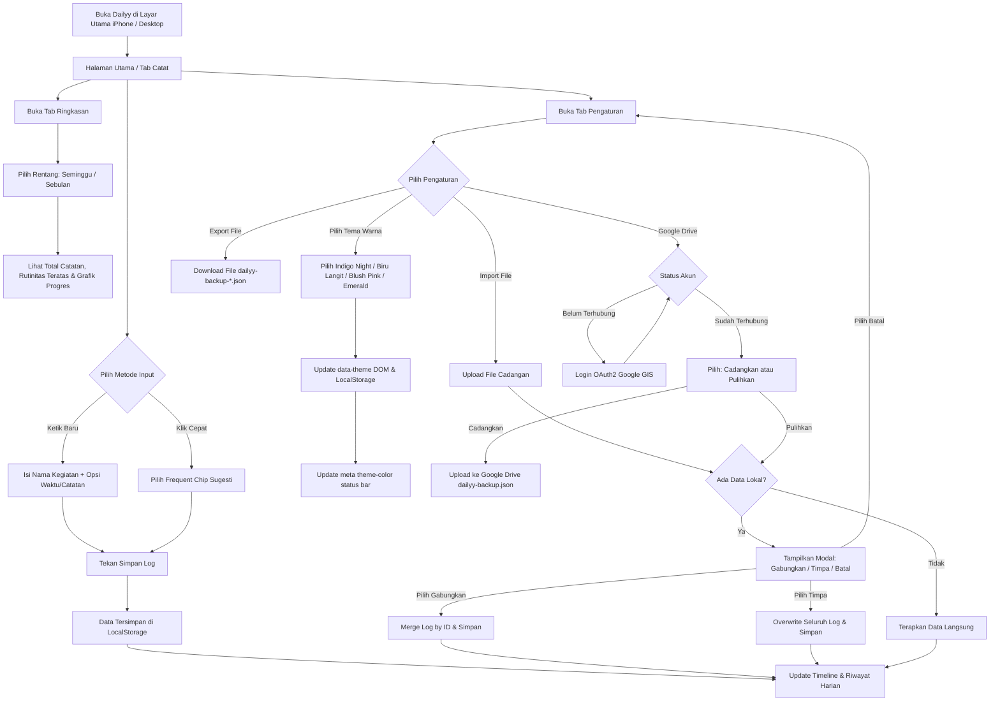

# Product Requirements Document (PRD) - v1.2

## Project: Dailyy - Personal Activity Log (Offline-First PWA)

---

### 📌 Dokumen Kontrol & Riwayat Versi (Changelog)

| Versi | Tanggal | Penulis | Ringkasan Perubahan Utama |
| :---: | :---: | :---: | :--- |
| **v1.0** | Awal Projek | Yodi | Dokumen awal MVP (Personal Activity Log / AktivitasKu). Scope: Offline-first PWA, input log, timeline, ringkasan mingguan/bulanan, backup JSON lokal. (Cloud sync dinyatakan out-of-scope). |
| **v1.1** | Oktober 2026 | Yodi & AI Assistant | **Revisi Sinkronisasi Status Aplikasi:** 1. Branding resmi menjadi **Dailyy**. 2. Peningkatan **Google Drive Backup & Restore (Zero-Cost Cloud Sync)** dari *Out of Scope* menjadi fitur utama. 3. Penambahan **Modal Konfirmasi Pemulihan Data (Merge vs Replace)** untuk mencegah kehilangan data. 4. Auto-refresh token Google OAuth (Error 401 recovery). 5. Integrasi halaman legalitas: **Privacy Policy** & **Terms of Service**. 6. PWA Auto-Update & tombol manual "Periksa Update". 7. Update Tech Stack ke Tailwind CSS v4 & Lucide Vue modern. 8. **Penyederhanaan UI/UX & Bahasa:** Menghapus istilah teknis developer (*file JSON*, *log*, *waktu custom*) menjadi bahasa ramah pengguna (*Cadangan File*, *Catatan*, *Atur Waktu*). 9. **Polish UI/UX & Mobile Ergonomics:** Pencegahan iOS auto-zoom via font 16px, pembesaran touch target tombol aksi riwayat, autofocus pada inline edit, penutupan modal via klik backdrop & tombol Escape, sinkronisasi immersive `theme-color` `#020617`, dan bilah progres statistik relatif terhadap rank #1. |
| **v1.2** | Oktober 2026 | Yodi & AI Assistant | **Fitur Kustomisasi Tema & Tampilan (Custom Themes):** 1. Penambahan pemilih tema di tab **Pengaturan** dengan 4 palet warna terkurasi: &nbsp;&nbsp;• **Indigo Night** (Default dark slate & indigo) &nbsp;&nbsp;• **Biru Langit** (Light mode cerah & segar, sky-50/sky-600) &nbsp;&nbsp;• **Blush Pink** (Light mode estetik & feminin untuk kaum hawa, rose-50/rose-600) &nbsp;&nbsp;• **Emerald Green** (Dark mode hijau alami segar, emerald-950/emerald-500) 2. Arsitektur tema terpadu via Tailwind CSS v4 dynamic design tokens (`--color-app-bg`, `--color-app-surface`, `--color-app-card`, `--color-app-border`, `--color-primary`, dll). 3. Penyimpanan preferensi tema persisten di `localStorage` (`dailyy_theme_v1`). 4. Anti-FOUC (Flash of Unstyled Content) script pada `index.html` untuk kenyamanan visual sejak render pertama. 5. Sinkronisasi dinamis `<meta name="theme-color">` serta adaptasi `apple-mobile-web-app-status-bar-style` (otomatis beralih ke `default` / teks hitam di mode terang agar jam & baterai tetap terlihat jelas, dan `black-translucent` di mode gelap). 6. Perbaikan layout tag/badge tema dan kartu pilihan agar responsif sempurna di layar iPhone 8 (375px) tanpa teks terpotong atau wrap berlebih. 7. Harmonisasi efek pendar cahaya (*luminous glow*) dan border tinting di seluruh tema. |

---

### 1. Ringkasan Eksekutif & Latar Belakang

**Dailyy** adalah aplikasi pencatat aktivitas harian personal (*habit & activity tracker*) yang dirancang khusus untuk memantau rutinitas dan frekuensi kegiatan sehari-hari (misalnya: *nyuci baju*, *olahraga*, *baca buku*, *belajar koding*).

Aplikasi ini mengedepankan prinsip:
1. **Local-First & Offline-Ready:** Data primer tersimpan aman di perangkat pengguna dan aplikasi dapat digunakan tanpa koneksi internet.
2. **PWA Standalone di iPhone 8 (iOS 16):** Dapat dipasang langsung melalui menu *"Add to Home Screen"* di Safari tanpa membutuhkan App Store.
3. **Zero-Cost (Rp 0):** Beroperasi tanpa biaya domain, server berbayar, database cloud komersial, maupun lisensi developer Apple.
4. **Cadangan Cloud Pribadi Bebas Biaya:** Pengguna dapat mencadangkan dan memulihkan data langsung ke Google Drive pribadi mereka secara aman via protokol OAuth2 resmi Google.
5. **Personalisasi & Aksesibilitas Visual:** Menyediakan pilihan nuansa warna (dark & light) yang nyaman bagi berbagai preferensi pengguna.

---

### 2. Sasaran & Kriteria Keberhasilan (Success Metrics)

- **Biaya Operasional Rp 0:** Seluruh arsitektur (hosting static, Google Drive API personal, service worker) berbiaya nol rupiah.
- **PWA Kompatibilitas iOS 16:** Berjalan *standalone* (fullscreen tanpa address bar Safari) dan mendukung safe-area insets pada iPhone 8.
- **Keandalan Mode Offline:** Aplikasi dapat dibuka, menampilkan riwayat, serta mencatat kegiatan baru meski perangkat berada dalam *Airplane Mode*.
- **Kecepatan Pencatatan (< 5 detik):** Alur pencatatan instan dengan tombol *quick chips* (sugesti satu klik).
- **Proteksi Data (Zero Data Loss):** Perlindungan penuh saat proses *restore* atau *import* data melalui opsi **Gabungkan (Merge)** atau **Timpa (Replace)**.
- **Transisi Tema Mulus & Bebas Glitch:** Pergantian tema berlangsung instan tanpa reload halaman, tanpa FOUC, dan tersimpan permanen di perangkat pengguna.

---

### 3. Batasan Platform & Perangkat

- **Target Perangkat Utama:** iPhone 8 (maksimal iOS 16.7.x) via Mobile Safari PWA.
- **Dukungan Lintas Platform:** Android (Google Chrome PWA) dan Desktop Browser (Chrome, Edge, Safari).
- **Desain & Responsivitas:** Desain ramah ibu jari (*thumb-zone navigation*), adaptif terhadap safe-area inset (bezel/notch), serta mendukung tema gelap maupun terang secara kontras tinggi.

---

### 4. Ruang Lingkup Fitur (Feature Scope v1.2)

#### 4.1. Quick Log Entry (Pencatatan Cepat)
- **Input Teks Utama:** Input nama kegiatan dengan placeholder intuitif dan atribut aksesibilitas (`aria-label`).
- **Pilihan Cepat (Frequent Chips):** Menampilkan hingga 6 kegiatan yang paling sering dilakukan pengguna + opsi kegiatan default (*Nyuci baju*, *Olahraga*, *Baca buku*, dll).
- **Pencatatan Waktu Real-Time:** Waktu kegiatan otomatis tercatat saat tombol simpan ditekan.
- **Mode Pengaturan Waktu (Atur Waktu):** Opsi penyesuaian tanggal & jam lampau via input `datetime-local` serta catatan tambahan (*optional note*).
- **Feedback Visual:** Banner notifikasi singkat saat catatan berhasil disimpan.

#### 4.2. Activity Timeline (Riwayat Aktivitas)
- **Pengelompokan Tanggal:** Catatan dikelompokkan per hari secara kronologis terbalik (*Hari Ini*, *Kemarin*, atau nama hari & tanggal lengkap).
- **Badge Hitungan Harian:** Menampilkan total frekuensi kegiatan pada hari tersebut.
- **Aksi Cepat per Item:**
  - **Inline Edit:** Mengubah judul dan catatan kegiatan langsung di kartu riwayat. Mendukung keyboard shortcut (`Enter` untuk simpan, `Esc` untuk batal).
  - **Hapus dengan Konfirmasi:** Tombol hapus dengan mode konfirmasi 2-langkah (*Hapus* / *Batal*) untuk mencegah penghapusan tidak sengaja.
- **State Kosong (Empty State):** Panduan visual menarik jika belum ada aktivitas tercatat.

#### 4.3. Statistik & Ringkasan (Activity Insights)
- **Filter Rentang Waktu Dinamis:**
  - **7 Hari Terakhir:** Analisis kebiasaan seminggu (rolling 7 days).
  - **30 Hari Terakhir:** Analisis kebiasaan sebulan (rolling 30 days).
- **Kartu Ringkasan Utama:**
  - **Total Catatan:** Akumulasi jumlah kegiatan pada rentang terpilih.
  - **Paling Sering (Trophy):** Kegiatan nomor satu dengan frekuensi dan persentase kontribusinya.
- **Daftar Frekuensi Kegiatan:** Rincian seluruh aktivitas terurut dari yang terbanyak, dilengkapi indikator ranking, jumlah hitungan (*times*), persentase, dan bilah progres (*progress bar* visual gradien).

#### 4.4. Kustomisasi Tema & Tampilan (Theme Customization - v1.2)
- **4 Pilihan Palet Warna Terkurasi:**
  1. **Indigo Night (Gelap Bawaan):** Mode gelap klasik dengan aksen indigo & ungu modern.
  2. **Biru Langit (Cerah & Segar):** Mode terang bersih bernuansa biru langit dan laut yang menyegarkan di siang hari.
  3. **Blush Pink (Kaum Hawa):** Mode terang lembut dan estetik bernuansa mawar/pink yang dirancang khusus untuk kenyamanan pengguna wanita.
  4. **Emerald Green (Hijau Alami):** Mode gelap menenangkan dengan aksen hijau zamrud yang sejuk di mata.
- **Live Preview & Indikator Aktif:** Kartu pilihan tema dilengkapi gelembung warna aksen & latar belakang, label kategori tema, serta centang status aktif.
- **Penyimpanan Lokal Persisten:** Disimpan di `localStorage` (`dailyy_theme_v1`) dan diinisialisasi secara otomatis tanpa FOUC.
- **Sinkronisasi Status Bar Perangkat:** Meta tag `theme-color` otomatis menyesuaikan warna tema aktif agar tampilan status bar iPhone/Android menyatu secara imersif.

#### 4.5. Cadangan File di Perangkat (Device File Backup)
- **Download File Cadangan:** Mengunduh seluruh riwayat catatan lokal ke file terstruktur `dailyy-backup-YYYY-MM-DD.json`.
- **Pulihkan dari File:** Membaca file backup dengan validasi skema array dan sanitasi waktu (`parseSafeTimestamp` anti-crash).
- **Dialog Proteksi Pemulihan Data:** Jika perangkat sudah memiliki data catatan, sistem menampilkan dialog interaktif:
  - **Gabungkan (Merge):** Menyatukan data cadangan dengan data yang sudah ada tanpa menghapus data lokal.
  - **Timpa Semua (Replace):** Mengganti seluruh data lokal dengan data file cadangan.
  - **Batal:** Membatalkan aksi pemulihan.
- **Zona Bahaya (Hapus Semua Data):** Opsi menghapus seluruh catatan lokal dengan konfirmasi ganda.

#### 4.6. Cadangan Cloud Pribadi (Google Drive Backup)
- **Arsitektur Zero-Cost Cloud:** Menggunakan Google Identity Services (GIS) OAuth2 client-side tanpa perantara server backend.
- **Keamanan & Privasi Terbatas (*Limited Use*):** Meminta scope aman `https://www.googleapis.com/auth/drive.file` — Dailyy hanya dapat membaca dan memperbarui 1 file miliknya sendiri: `dailyy-backup.json`.
- **Auto-Refresh Token (Error 401 Recovery):** Mekanisme pembaruan token otomatis saat access token Google kedaluwarsa setelah 1 jam.
- **Profil Akun Terhubung:** Menampilkan avatar, nama, dan email pengguna Google serta waktu pencadangan terakhir.
- **Cadangkan & Pulihkan:** Sinkronisasi 1-klik untuk upload dan download data ke/dari Google Drive pribadi pengguna, lengkap dengan proteksi dialog konfirmasi penggabungan data.

#### 4.7. PWA, Service Worker & Offline Capability
- **Precache Lengkap:** Service Worker Workbox mem-precache seluruh aset statis (HTML, CSS, JS modul, ikon PWA).
- **Auto-Update & Manual Check:** Deteksi versi baru secara otomatis serta tombol manual *"Periksa Versi Baru"* di tab Pengaturan.
- **Status Jaringan Real-Time:** Banner pill di header yang memberi tahu pengguna saat berada dalam status *Online* maupun *Offline*.
- **Panduan Instalasi Universal:** Panduan jelas di tab Pengaturan untuk memasang PWA di iOS (Safari) dan Android (Chrome).

#### 4.8. Legalitas & Kepatuhan Kebijakan
- **Kebijakan Privasi (`/privacy.html`):** Memenuhi standar *Google API Services User Data Policy* dan transparansi data lokal.
- **Ketentuan Layanan (`/terms.html`):** Regulasi penggunaan aplikasi dan batasan jaminan layanan.

---

### 5. Fitur yang Ditunda (Out of Scope untuk v1.2 - Rencana v2.0)

- ⏳ Kategori / Tag kustom dengan warna khusus untuk setiap aktivitas.
- ⏳ Ekspor statistik ke format spreadsheet (CSV / Excel) atau laporan PDF.
- ⏳ Grafik tren aktivitas per jam dalam sehari (*heatmap / hourly distribution*).
- ⏳ Pengingat terjadwal lokal (*Local Notification API* jika didukung di iOS PWA).

---

### 6. Arsitektur Teknis (Tech Stack v1.2)

| Lapisan | Teknologi | Versi | Peran & Alasan |
| :--- | :--- | :--- | :--- |
| **Framework** | Vue 3 | `^3.5.x` | Composition API, `<script setup>`, reaktif, ringan. |
| **Build Tool** | Vite | `^8.3.x` | Bundler super cepat, HMR instan, optimasi rollup. |
| **Styling & Tema** | Tailwind CSS v4 | `^4.3.x` | Desain utilitas modern via `@tailwindcss/vite` & CSS Variables `@theme`. |
| **PWA Engine** | `vite-plugin-pwa` | `^2.0.x` | Manajemen Service Worker, Workbox, dan Manifest otomatis. |
| **Ikon UI** | `@lucide/vue` | `^1.54.x` | Paket ikon SVG modern, konsisten, dan berukuran kecil. |
| **Cloud Auth & API** | Google Identity Services (GIS) | SDK Client | Autentikasi OAuth2 client-side tanpa backend untuk Google Drive. |
| **Penyimpanan Lokal** | Web Storage API (LocalStorage) | `dailyy_logs_v1` & `dailyy_theme_v1` | Penyimpanan lokal instan untuk catatan kegiatan dan preferensi tema. |
| **Hosting & Deploy** | Cloudflare Pages / Vercel / GitHub Pages | - | Gratis selamanya, CDN global, otomatis HTTPS. |

---

### 7. Diagram Alur Pengguna (User Flow v1.2)

---

### 8. Status Roadmap & Langkah Selanjutnya

- [x] **Fase 1: Setup Projek & PWA Engine** (Selesai)
- [x] **Fase 2: Komponen Input & Timeline Harian** (Selesai)
- [x] **Fase 3: Agregasi Statistik Mingguan & Bulanan** (Selesai)
- [x] **Fase 4: Backup Manual JSON & Polishing Desain iPhone 8** (Selesai)
- [x] **Fase 5: Integrasi Google Drive Sync & Halaman Legalitas** (Selesai)
- [x] **Fase 6: Audit Komprehensif, Auto 401 Refresh, & Modal Anti-Data Loss** (Selesai di v1.1)
- [x] **Fase 7: Kustomisasi Tema Warna (4 Palet Terkurasi, Anti-FOUC, Status Bar Sync)** (Selesai di v1.2)
- [ ] **Fase 8: Evaluasi Fitur v2.0 (Kategori Kegiatan & Visualisasi Lanjutan)**

